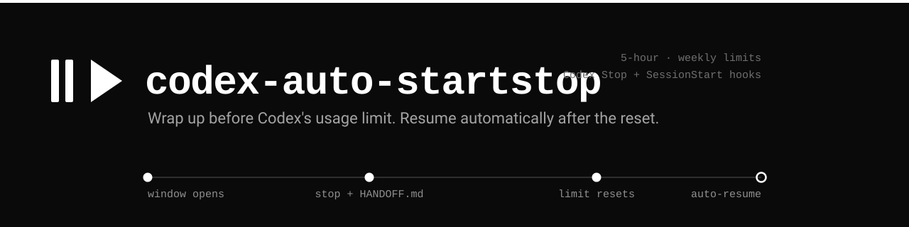

# codex-auto-startstop

[](https://github.com/IsmailAzzouz/codex-auto-startstop/actions/workflows/ci.yml)
[](LICENSE)

Automatically hand off a Codex task before a usage limit and resume it in the same session after the limit resets.

Uses Codex's `Stop` and `SessionStart` hooks, with no third-party Python dependencies.

## How it works

At the end of a turn, the `Stop` hook checks the session's locally recorded usage. When the configured threshold is reached, it asks Codex to write a `HANDOFF.md` summary and stop. A detached helper then schedules a continuation through `codex queue` after the reset. The `SessionStart` hook can re-arm a pending continuation after a restart.

By default, the tool monitors the 5-hour usage window at 85%. It can also monitor the weekly window. Optional reset credits can bypass the handoff when a redemption succeeds.

## Requirements

- Codex CLI 0.160 or later
- Python 3.10 or later
- Linux or macOS (tested by CI)

Automatic message delivery uses Codex's app-server and queue support. Check your CLI version with `codex --version`.

## Installation

Choose one method. Installing both the plugin and the standalone hooks will register duplicate hooks.

### Plugin (recommended)

```bash
codex plugin marketplace add IsmailAzzouz/codex-auto-startstop
codex plugin add codex-auto-startstop@codex-auto-startstop
```

Restart Codex, review the `Stop` and `SessionStart` hook commands, and approve them when prompted. Verify the installation with `codex plugin list`.

### Standalone

```bash
git clone https://github.com/IsmailAzzouz/codex-auto-startstop.git
python3 codex-auto-startstop/codex_auto_startstop.py install
```

The installer copies the script to `~/.codex/auto-startstop/`, creates a default configuration, seeds the editable handoff prompt (see [Handoff prompt](#handoff-prompt)), and registers the hooks in `~/.codex/hooks.json`. Review and approve the hooks if Codex requests it.

## Configuration

Configuration is read from `~/.codex/auto-startstop/config.json`. The standalone installer creates this file; plugin installations use built-in defaults until you create it.

| Option | Default | Description |
| --- | --- | --- |
| `trigger` | `"5h"` | Handoff trigger: `5h`, `weekly`, or `both` |
| `stop_percent` | `85.0` | 5-hour usage threshold (%) |
| `stop_percent_weekly` | `90.0` | Weekly usage threshold (%) |
| `resume_buffer_sec` | `90` | Delay in seconds after the reset |
| `resume` | `true` | Enable automatic continuation |
| `handoff_file` | `"HANDOFF.md"` | Handoff filename in the session working directory |
| `notify_desktop` | `true` | Enable desktop notifications when supported |
| `use_reset_credits` | `false` | Allow automatic redemption of reset credits |
| `reset_credit_on` | `"weekly"` | Window eligible to trigger redemption: `5h`, `weekly`, or `both` |
| `codex_bin` | `"codex"` | Codex executable path |
| `python` | Current interpreter | Python executable used for the helper |

For example, to monitor both usage windows, set:

```json
{
  "trigger": "both"
}
```

The tool checks thresholds at turn boundaries, so a handoff is not guaranteed before an active turn exhausts the available usage.

### Handoff prompt

The prompt that asks Codex to wrap up lives in its own markdown file, so you can reword it without touching the script or the JSON config:

- Plugin installs read `prompts/handoff.md` from the plugin folder.
- Standalone installs seed `~/.codex/auto-startstop/handoff-prompt.md` on first install; edit that copy.

At send time the `Stop` hook fills in `{window}`, `{percent}`, `{minutes_left}`, `{reset_local}`, `{handoff_file}`, and `{handoff_path}`. Keep `{handoff_file}` so Codex knows which file to write. For compatibility, a `stop_message` value in `config.json` still overrides the file.

The prompt file is optional and never fatal: if it is missing, empty, unreadable, larger than 64 KiB, or not valid UTF-8, the built-in prompt is used instead. A UTF-8 BOM and Windows line endings are normalised, and a literal `{` or `}` in your markdown (a JSON or code sample) does not stop the placeholders from being filled in.

### Optional reset credits

If your Codex account has usage-limit reset credits, setting `use_reset_credits` to `true` permits the tool to redeem one automatically when a selected window reaches its threshold. A successful redemption skips the handoff and wait; if redemption is unavailable or fails, the normal handoff flow applies.

`reset_credit_on` selects which window can trigger a redemption attempt. It is `"weekly"` by default. With reset credits enabled, that window is monitored even if it is not selected by `trigger`, so a failed attempt can still fall back to a handoff.

**Enabling this option can spend real credits from your account without further confirmation.** It is disabled by default.

## Status and logs

Run these commands from a repository checkout, or replace the script path with your installed copy:

```bash
python3 codex_auto_startstop.py status
python3 codex_auto_startstop.py status --thread <session-id>
python3 codex_auto_startstop.py credits
```

For standalone installations, the script is at `~/.codex/auto-startstop/codex_auto_startstop.py`.

Runtime state and logs are stored in `~/.codex/auto-startstop/`. To inspect the log:

```bash
tail -f ~/.codex/auto-startstop/auto-startstop.log
```

## Limitations

- The `Stop` hook runs at turn boundaries; it cannot interrupt a turn that has already reached the usage limit.
- The handoff is an instruction to Codex, not a guarantee that `HANDOFF.md` will be written. If it is missing, the continuation message asks Codex to reconstruct the task status.
- If the machine is off when a reset occurs, the helper cannot run. The `SessionStart` hook can re-arm pending work when the session is opened again.
- If there is user activity after the reset, automatic continuation is skipped to avoid interrupting ongoing work.
- Queued continuation depends on the Codex CLI's app-server and message queue behavior.

## Uninstall

For a plugin installation:

```bash
codex plugin remove codex-auto-startstop@codex-auto-startstop
```

For a standalone installation:

```bash
python3 ~/.codex/auto-startstop/codex_auto_startstop.py uninstall
```

Add `--purge` to the standalone uninstall command to remove runtime state. This does not automatically remove previously trusted hook entries from Codex's configuration.

## Tests

```bash
python3 tests/synthetic_test.py
```

The synthetic suite tests threshold decisions, per-window deduplication, resume scheduling, activity checks, and reset-credit decisions without consuming real account credits. GitHub Actions runs it on Linux and macOS with Python 3.10 and 3.13.

Reset-credit redemption is tested with a simulated app-server; it has not been verified by spending a real credit as part of the test suite.

## License

MIT. See [LICENSE](LICENSE).
