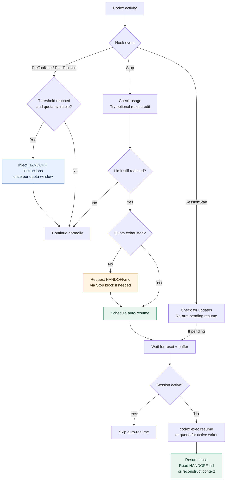

# codex-auto-startstop

[](https://github.com/IsmailAzzouz/codex-auto-startstop/actions/workflows/ci.yml)
[](LICENSE)
[](https://github.com/IsmailAzzouz/codex-auto-startstop/releases/latest)

Automatically hand off a Codex task before a usage limit and resume it in the same session after the limit resets.

Uses Codex's `PreToolUse`, `PostToolUse`, `Stop`, and `SessionStart` hooks, with no
third-party Python dependencies.

## How it works

At the end of a turn, the `Stop` hook checks the session's locally recorded usage. When the configured threshold is reached, it asks Codex to write a `HANDOFF.md` summary and stop. A detached helper then runs `codex exec resume <SESSION_ID>` with the handoff message after the reset. This starts a real turn even when the thread is unloaded. If an existing Codex client owns the thread, it falls back to `codex queue`. The `SessionStart` hook can re-arm a pending continuation after a restart.

The `PreToolUse` and `PostToolUse` hooks run the same check at every tool call. When
the threshold is reached, they inject the handoff instruction once per window. This
gives a long turn an earlier warning, before its next turn boundary.

By default, the tool monitors the 5-hour usage window at 85%. It can also monitor the weekly window. Optional reset credits can bypass the handoff when a redemption succeeds.


### Workflow diagram

GitHub renders this Mermaid diagram directly in the README. The normal path requires **no reset credits** and never spends them unless the user explicitly opts in.



*The tool hooks check usage only when a tool runs, and the Stop hook checks at a
turn boundary.* Reaching the threshold cannot interrupt a model response already in
flight, and the handoff instruction is not a guarantee that Codex will write the
file. If Codex is already exhausted, the hook can schedule recovery without asking
the model to write a report. If the machine is off at reset, the helper cannot
deliver the message until Codex runs again and SessionStart re-arms it. Resume is
optional, and existing user activity prevents an automatic interruption.

## Requirements

- Codex CLI 0.160 or later
- Python 3.10 or later
- Windows, Linux, or macOS (tested by CI)

Default unattended continuation uses `codex exec resume`, which executes the saved thread without an open TUI. The optional queue mode requires a loaded thread for automatic dispatch. Check your CLI version with `codex --version`.

## Installation

Choose one method. Installing both the plugin and the standalone hooks will register duplicate hooks.

### Plugin (recommended)

```bash
codex plugin marketplace add IsmailAzzouz/codex-auto-startstop
codex plugin add codex-auto-startstop@codex-auto-startstop
```

Restart Codex, **review the hook commands and explicitly approve them** in the
interactive hook review flow. Installing the plugin does not grant execution
permission. Verify the installation with `codex plugin list`. If the desktop app
does not show an approval prompt, use the interactive CLI to review pending hooks.

### Standalone

```bash
git clone https://github.com/IsmailAzzouz/codex-auto-startstop.git
python3 codex-auto-startstop/codex_auto_startstop.py install
```

On Windows PowerShell, use the Python launcher instead:

```powershell
git clone https://github.com/IsmailAzzouz/codex-auto-startstop.git
py -3 .\codex-auto-startstop\codex_auto_startstop.py install
```

The installer copies the script to `~/.codex/auto-startstop/`, creates a default configuration, seeds the editable handoff prompt (see [Handoff prompt](#handoff-prompt)), and registers the hooks in `~/.codex/hooks.json`. **It never edits `config.toml` to trust hooks automatically.** Open interactive Codex, inspect the registered commands, and explicitly approve each one before expecting them to run. An untrusted hook will be skipped.

### Recognizing hooks in Codex

For standalone installs, commands point to `~/.codex/auto-startstop/codex_auto_startstop.py` with `stop`, `session-start`, or `checkpoint`. On Windows they use Windows-safe double quotes. Plugin hooks use `python3` and `${PLUGIN_ROOT}` on Linux/macOS, and the official `commandWindows` override (`py -3` and `%PLUGIN_ROOT%`) on Windows. Each handler has a descriptive `statusMessage`.

Some Codex versions display **"Hook 1", "Hook 2", or "unknown"** rather than a custom title. Codex currently lacks a supported per-hook display-name field: `statusMessage` helps in expanded details but does not override every client's row title. Identify hooks by their **event, source, and command**. See the [upstream naming limitation](https://github.com/openai/codex/issues/41611).

Before trusting a command, inspect the file it executes. Do not use `--dangerously-bypass-hook-trust` as an installation step.

## Configuration

Configuration is read from `~/.codex/auto-startstop/config.json`. The standalone installer creates this file; plugin installations use built-in defaults until you create it.

| Option | Default | Description |
| --- | --- | --- |
| `trigger` | `"5h"` | Handoff trigger: `5h`, `weekly`, or `both` |
| `stop_percent` | `85.0` | 5-hour usage threshold (%) |
| `stop_percent_weekly` | `90.0` | Weekly usage threshold (%) |
| `resume_buffer_sec` | `90` | Delay in seconds after the reset |
| `resume` | `true` | Enable automatic continuation |
| `resume_method` | `"auto"` | `auto`: execute a saved thread; queue only if an active writer prevents a second executor. `exec`: only run headless. `queue`: only enqueue (may wait for manual session reopening). |
| `handoff_file` | `"HANDOFF.md"` | Handoff filename in the session working directory |
| `notify_desktop` | `true` | Enable desktop notifications when supported |
| `check_updates` | `true` | Check GitHub for a newer release at session start |
| `update_check_hours` | `24` | Hours between update checks |
| `update_url` | latest release page | Page used by the check; override for a fork |
| `use_reset_credits` | `false` | Allow automatic redemption of reset credits |
| `reset_credit_on` | `"weekly"` | Window eligible to trigger redemption: `5h`, `weekly`, or `both` |
| `codex_bin` | `"codex"` | Codex executable path |
| `python` | Current interpreter | Python executable used for the helper |

For example, to monitor both usage windows, set:

```json
{
  "trigger": "both"
}
```

The tool checks thresholds at turn boundaries, so a handoff is not guaranteed before an active turn exhausts the available usage.

### Handoff prompt

The prompt that asks Codex to wrap up lives in its own markdown file, so you can reword it without touching the script or the JSON config:

- Plugin installs read `prompts/handoff.md` from the plugin folder.
- Standalone installs seed `~/.codex/auto-startstop/handoff-prompt.md` on first install; edit that copy.

At send time the `Stop` hook fills in `{window}`, `{percent}`, `{minutes_left}`, `{reset_local}`, `{handoff_file}`, and `{handoff_path}`. Keep `{handoff_file}` so Codex knows which file to write. For compatibility, a `stop_message` value in `config.json` still overrides the file.

The prompt file is optional and never fatal: if it is missing, empty, unreadable, larger than 64 KiB, or not valid UTF-8, the built-in prompt is used instead. A UTF-8 BOM and Windows line endings are normalised, and a literal `{` or `}` in your markdown (a JSON or code sample) does not stop the placeholders from being filled in.


### Update notifications

At session start, the tool asks GitHub for the newest release tag. When a newer
version exists, it shows the update command once for that version. The check
does not block the session when the network is down or the URL is unreachable.

- Plugin install: `codex plugin marketplace upgrade codex-auto-startstop`
- Standalone install: update your checkout, then run `python3 codex_auto_startstop.py install`
- Codex asks you to approve the hooks again after an update. Hook trust is bound
  to the script content, so this prompt is expected.
- The check makes one HTTPS request to the release page, at most once every
  `update_check_hours`. The result is stored in `~/.codex/auto-startstop/update.json`.
- The request must stay on the configured host over HTTPS. The tool refuses a
  redirect to another host or to plain HTTP.
- Set `check_updates` to `false` to disable the check.

### Optional reset credits

If your Codex account has usage-limit reset credits, setting `use_reset_credits` to `true` permits the tool to redeem one automatically when a selected window reaches its threshold. A successful redemption skips the handoff and wait; if redemption is unavailable or fails, the normal handoff flow applies.

`reset_credit_on` selects which window can trigger a redemption attempt. It is `"weekly"` by default. With reset credits enabled, that window is monitored even if it is not selected by `trigger`, so a failed attempt can still fall back to a handoff.

**Enabling this option can spend real credits from your account without further confirmation when the selected window reaches its threshold.** It is disabled by default (`false`), and the installer does not enable it. Only opt in if you accept this automatic consumption.

## Status and logs

Run these commands from a repository checkout, or replace the script path with your installed copy:

```bash
python3 codex_auto_startstop.py status
python3 codex_auto_startstop.py status --thread <session-id>
python3 codex_auto_startstop.py credits
```

On Windows, replace `python3` with `py -3` and `/` with `\` where a path is shown.

For standalone installations, the script is at `~/.codex/auto-startstop/codex_auto_startstop.py`.

Runtime state and logs are stored in `~/.codex/auto-startstop/`. To inspect the log:

```bash
tail -f ~/.codex/auto-startstop/auto-startstop.log
```

Every normal `Stop` run records the observed quota and threshold, for example:

```text
stop: below threshold session=<id> trigger=5h 5h=41.0% used (threshold=85.0%) (...)
```

`no readable rate-limit data` is reserved for a missing or incompatible quota snapshot. It is not used when a valid quota is simply below the threshold.

For a plugin install, the runtime state remains under `~/.codex/auto-startstop/`, but the script lives in the plugin directory. To run `status` without a source checkout:

```bash
script="$(find ~/.codex -type f -name codex_auto_startstop.py -path '*codex-auto-startstop*' -print -quit)"
python3 "$script" status --thread <session-uuid>
```

## Limitations

- The `PreToolUse` and `PostToolUse` hooks run only when a tool runs. A turn with no tool calls reaches only the `Stop` hook.
- The `Stop` hook runs at turn boundaries; it cannot interrupt a turn that has already reached the usage limit.
- The handoff is an instruction to Codex, not a guarantee that `HANDOFF.md` will be written. If it is missing, the continuation message asks Codex to reconstruct the task status.
- If the machine is off when a reset occurs, the helper cannot run. The `SessionStart` hook can re-arm pending work when the session is opened again.
- For a weekly reset several days away, the detached helper remains alive until the scheduled continuation (unless the machine or process stops); there is no eight-hour cutoff.
- If there is user activity after the reset, automatic continuation is skipped to avoid interrupting ongoing work.
- Default automatic continuation runs non-interactively in the original working directory. Changes and transcript are saved in the same session, but a closed Codex UI will not automatically reopen.
- If a headless run fails or is interrupted, the helper stops rather than repeating potentially non-idempotent edits. Inspect `status` and the log before retrying manually.
- `resume_method: "queue"` is kept for compatibility. An unloaded thread can accept a queued message **without starting a turn** (see [upstream issue #44491](https://github.com/openai/codex/issues/44491)); use the default `auto` for unattended work.
- Automatic continuation requires the original project directory, an installed Codex CLI and a valid Codex login. It cannot execute while the machine is powered off.

## Uninstall

For a plugin installation:

```bash
codex plugin remove codex-auto-startstop@codex-auto-startstop
```

For a standalone installation:

```bash
python3 ~/.codex/auto-startstop/codex_auto_startstop.py uninstall
```

On Windows PowerShell:

```powershell
py -3 $HOME\.codex\auto-startstop\codex_auto_startstop.py uninstall
```

Add `--purge` to the standalone uninstall command to remove runtime state. This does not automatically remove previously trusted hook entries from Codex's configuration. Entries written by versions before 1.0.1 are not revoked automatically; review them manually if necessary.

## Tests

```bash
python3 tests/synthetic_test.py
```

The synthetic suite tests threshold decisions, per-window deduplication, headless resume execution, active-writer queue fallback, protection against duplicate attempts, activity checks, reset-credit decisions, and platform-specific command generation without consuming real account credits. GitHub Actions runs it on Windows, Linux, and macOS with Python 3.10 and 3.13. The release-shell tests run on Linux and macOS because release publication is a Bash workflow.

Reset-credit redemption is tested with a simulated app-server; it has not been verified by spending a real credit as part of the test suite.


## Development and automatic GitHub releases

All pull requests and pushes to `main` run the **six CI test jobs** (Windows, Linux, and macOS with Python 3.10 and 3.13). They cover the hooks, installation safety, and release-version logic; Bash-only release simulations run on Linux and macOS. **A failed or cancelled test job prevents publication.** Forked pull requests run with read-only permissions and never publish releases.

For each successful, new push to `main`, the release job:

1. Selects the next `vMAJOR.MINOR.PATCH` version. A manually committed higher version (for example `1.2.0`) is respected; otherwise, the patch version increments.
2. Synchronizes the version in `codex_auto_startstop.py` and `.codex-plugin/plugin.json`. When a bump is needed, it makes a version-only `chore(release)` commit on `main` with `[skip ci]`.
3. Creates an annotated Git tag and publishes a GitHub Release with automatically generated release notes. The source ZIP and tarball are automatically provided by GitHub.

No personal access token or third-party publishing service is necessary: only the publish job receives `GITHUB_TOKEN` with `contents: write`. The workflow serializes releases, never overwrites an existing version tag, and can be rerun without creating a duplicate. If another commit arrives before an older run can publish, the newer CI run becomes responsible for the latest code, rather than releasing an untested commit.

The current workflow uses a small version-only commit on `main` to keep the published source and plugin versions consistent. **If you enable branch protection that blocks GitHub Actions from pushing to `main`, this step will fail safely; allow this narrow automation or migrate to a release-PR approach.** Release publication does not run for a PR or before it is merged.

Releases: [latest version](https://github.com/IsmailAzzouz/codex-auto-startstop/releases/latest) · [CI and release workflow](.github/workflows/ci.yml).

## License

MIT. See [LICENSE](LICENSE).
