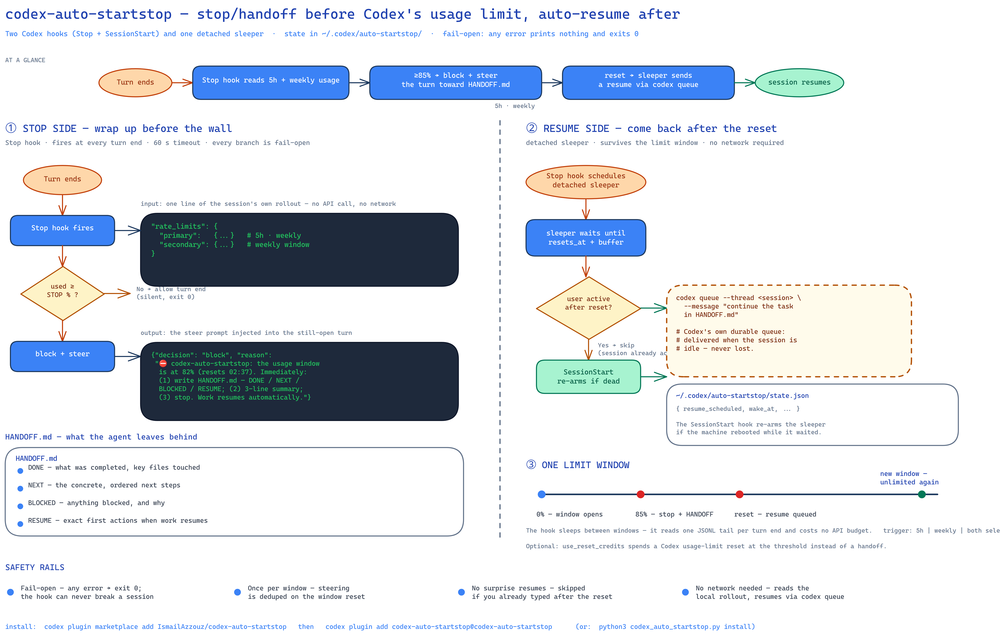

# codex-auto-startstop

**Wrap up before Codex's usage limit. Resume automatically after the reset.**

[](tests/synthetic_test.py)
[](codex_auto_startstop.py)
[](LICENSE)
[](https://github.com/openai/codex)

Codex stops accepting turns when you reach a usage limit. This usually happens mid-task.
The turn then fails, and the model writes no summary. You lose context.

codex-auto-startstop watches the limit inside the session. Just before the wall, it steers
Codex to stop and write a short handoff report (`DONE` / `NEXT` / `BLOCKED` / `RESUME`).
After the window resets, it sends a *continue* message into the same session.
Work picks up where it left off. You do not re-derive "where was I" between windows.



## What it does

| Step | Action |
|---|---|
| Before the limit | The `Stop` hook reads the usage from the session's own rollout file. At the threshold it blocks the stop and injects one instruction: write `HANDOFF.md`, then stop. |
| After the reset | A detached sleeper waits for the reset. Then it sends the continue message with `codex queue`, Codex's durable message queue. |
| After a reboot | The `SessionStart` hook re-arms the sleeper if it died with the machine. |
| Reset credit (optional) | If a usage-limit reset credit is available, the tool spends it at the threshold and continues. No handoff, no wait. |

The tool is one Python file. It uses the standard library only. It needs no service and no
network call.

## Which limit drives it

Codex reports two windows in each session. The `trigger` setting selects which one the tool
watches.

| `trigger` | Acts on |
|---|---|
| `5h` (default) | the 5-hour window only |
| `weekly` | the 7-day window only |
| `both` | the window that is closest to its own limit |

Each window has its own threshold: `stop_percent` for 5h, `stop_percent_weekly` for weekly.
The tool steers once per window. It dedupes on the window reset time.

The tool steers once per window. It dedupes on the window reset time.

## Reset credits (optional)

Codex holds redeemable **usage limit resets** (reset credits). A credit clears the
eligible windows immediately. Set `use_reset_credits` to `true` to spend a credit at
the threshold instead of writing a handoff.

`reset_credit_on` selects the window that justifies a credit. The default is `weekly`,
because waiting for a weekly reset costs days.

With `reset_credit_on: "weekly"`:

| 5h window | weekly window | Action |
|---|---|---|
| near limit | far | handoff. No credit. Resume at the 5h reset. |
| far | near limit | credit. Continue. No handoff. |
| near limit | near limit | credit. Continue. No handoff. |

With `reset_credit_on: "5h"`, a near-limit 5h window spends a credit. A near-limit
weekly window alone then hands off. With `reset_credit_on: "both"`, either window spends
a credit.

When a credit is not available, or the redeem fails, the tool writes the handoff. The
tool records one attempt per window, so it never spends two credits for the same window.

Restart-free check:

```bash
python3 ~/.codex/auto-startstop/codex_auto_startstop.py credits
```

## Requirements

- Codex CLI version 0.160 or later. Run `codex --version` to check.
- Python 3.10 or later.
- Interactive sessions keep the Codex app-server daemon running. This is the default.
  `codex queue` uses the daemon. If the daemon is down, the message waits in the durable
  queue and arrives when you next open the session.

## Install

Use **one** method. If you install both the plugin and the hooks.json entry, both copies run.

### Option A — Codex plugin (recommended)

```bash
codex plugin marketplace add IsmailAzzouz/codex-auto-startstop
codex plugin add codex-auto-startstop@codex-auto-startstop
```

The plugin ships the `Stop` and `SessionStart` hooks. On the next interactive `codex` start,
Codex asks you to review the hooks. Select **"Trust all and continue"**. Codex does not run
untrusted hooks.

Confirm the install:

```bash
codex plugin list
```

Update later with `codex plugin marketplace upgrade`, then run the `add` command again.

### Option B — run the installer

Clone the repository and run the installer. It copies the script, writes a default config,
merges the two hooks into `~/.codex/hooks.json`, and seeds the hook trust entries. It asks
Codex for the hook hashes.

```bash
git clone https://github.com/IsmailAzzouz/codex-auto-startstop
python3 codex-auto-startstop/codex_auto_startstop.py install
```

If trust seeding fails, Codex offers the hooks for review on the next start. Select
**"Trust all and continue"** once.

### Option C — ask Codex to install it

Paste this into Codex:

> Install codex-auto-startstop for me. Get `codex_auto_startstop.py` from
> `https://github.com/IsmailAzzouz/codex-auto-startstop`, put it in `~/.codex/auto-startstop/`,
> then add a `Stop` hook and a `SessionStart` hook to `~/.codex/hooks.json`. The Stop hook runs
> `python3 ~/.codex/auto-startstop/codex_auto_startstop.py stop`. The SessionStart hook runs
> `python3 ~/.codex/auto-startstop/codex_auto_startstop.py session-start`. Then verify that
> the hooks are trusted.

## Configure

Edit `~/.codex/auto-startstop/config.json`.

| Key | Default | Meaning |
|---|---|---|
| `trigger` | `"5h"` | Which limit drives the stop and resume: `5h`, `weekly`, or `both`. |
| `use_reset_credits` | `false` | Spend Codex usage-limit reset credits instead of a handoff. |
| `reset_credit_on` | `"weekly"` | Window that justifies a credit: `weekly`, `5h`, or `both`. |
| `stop_percent` | `85.0` | Steer when the 5-hour window reaches this percentage. |
| `stop_percent_weekly` | `90.0` | Steer when the weekly window reaches this percentage. |
| `resume_buffer_sec` | `90` | Wait this long after the reset before the continue message. |
| `handoff_file` | `"HANDOFF.md"` | Report file name. The tool writes it in the project root. |
| `resume` | `true` | Set to `false` to keep the handoff but disable auto-resume. |
| `notify_desktop` | `true` | Send a desktop notification on auto-stop and auto-resume. |
| `codex_bin` | `"codex"` | Path to the Codex binary. |
| `python` | auto | Interpreter that the hooks use to start the sleeper. |

The message templates `stop_message`, `resume_message`, and `session_start_context` accept
`{percent}`, `{reset_local}`, `{minutes_left}`, `{handoff_file}`, and `{window}`.

To wait longer before the handoff, raise the threshold to about 92. The report itself uses
budget.

## Use and inspect

Run Codex as usual. Nothing changes until a window nears its threshold.

```bash
python3 ~/.codex/auto-startstop/codex_auto_startstop.py status            # limits + state
python3 ~/.codex/auto-startstop/codex_auto_startstop.py status --thread <id>
python3 ~/.codex/auto-startstop/codex_auto_startstop.py credits           # available reset credits
tail -f ~/.codex/auto-startstop/auto-startstop.log
```

The `status` command works from any copy of the script, including the copy that the plugin
installs. The runtime state lives in `~/.codex/auto-startstop/`.

## Uninstall

Plugin install:

```bash
codex plugin remove codex-auto-startstop@codex-auto-startstop
```

Installer install:

```bash
python3 ~/.codex/auto-startstop/codex_auto_startstop.py uninstall           # remove the hooks
python3 ~/.codex/auto-startstop/codex_auto_startstop.py uninstall --purge   # remove state
```

## Notes and limits

- The tool writes the handoff report in the session working directory, which is the project
  root.
- If the wall is hit during a turn, the threshold check has not run. The resume message then
  tells the model to reconstruct a short status first. The handoff is later than ideal, but
  auto-resume still works.
- The `both` trigger steers on the window that is closest to its own limit. If both windows
  fire at once, the resume waits for the later reset.
- Environment overrides for tests: `CODEX_AUTO_STARTSTOP_STOP_PERCENT`,
  `CODEX_AUTO_STARTSTOP_FORCE_RESUME_IN`, `CODEX_AUTO_STARTSTOP_NO_SPAWN=1`,
  `CODEX_AUTO_STARTSTOP_SESSIONS_DIR`, `CODEX_AUTO_STARTSTOP_CODEX_BIN`.

## Verified

Live-tested end to end on 2026-10-09, with codex-cli 0.160.0 on Linux/tmux and a real account.
No mocks.

1. A turn ends with the window at the threshold. The TUI shows `Blocked by hook`. The tool
   injects the steering message. The agent writes `HANDOFF.md` and stops.
2. The sleeper delivers the resume message through `codex queue` into the same live session.
   The agent continues.
3. The full plugin path was verified live: `codex plugin marketplace add`, `codex plugin add`,
   the trust review, the Stop interception, `HANDOFF.md`, and auto-resume.

`tests/synthetic_test.py` covers the decision logic: the threshold, the per-window dedupe,
the weekly and `both` triggers, the reset-credit decisions, the resume schedule, and the
activity check. It runs on Python 3.10 to 3.13 on Linux and macOS. See
`.github/workflows/ci.yml`.

The suite does not spend a real reset credit. It uses a fake app-server. A live redeem
spends one credit from your account.

## License

MIT. See [LICENSE](LICENSE).
